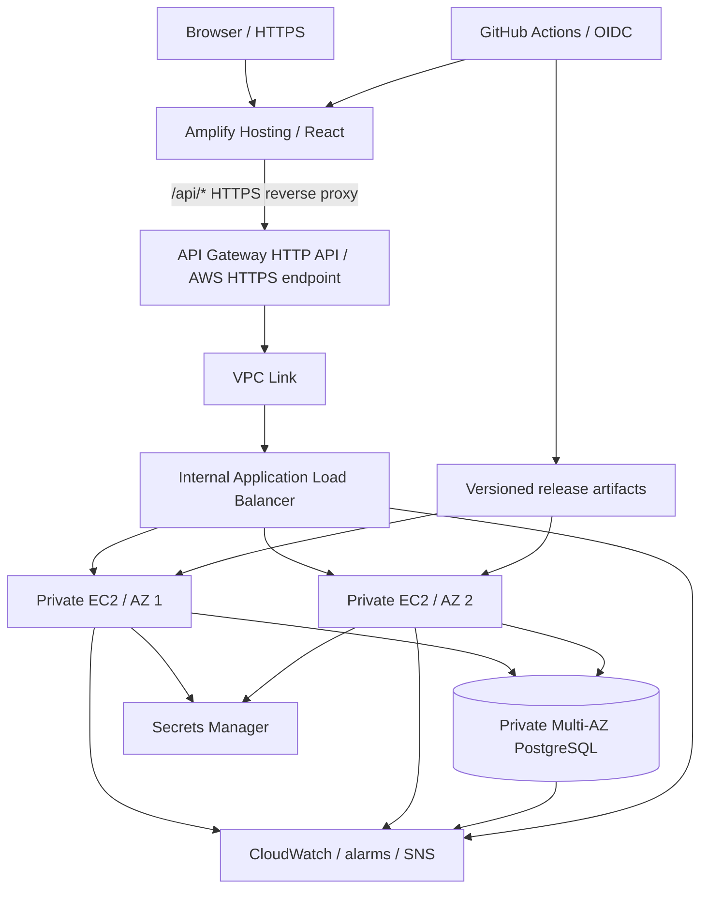

# People — employee workspace

React frontend, Node.js REST API and PostgreSQL, with an AWS CDK stack and GitHub Actions delivery pipeline.

**Target AWS account:** `912010732788` · **Default region:** `us-east-1`.

**Deployment status:** source code is implemented and locally validated. AWS deployment, a live URL, SNS delivery, EC2 resilience tests and GitHub-to-AWS delivery require an authorized AWS identity and have not been demonstrated by local tests. A stack output is not a live application until the release job finishes.

## Run locally

Use Node.js 24 on Linux/macOS, with npm. No Docker, external database, AWS credentials or domain is needed for local development.

```sh
npm ci
npm run dev:local
```

This starts a persistent local PostgreSQL instance and both development servers. The frontend listens on port 5173 and proxies `/api` to the backend on port 8080. Local administrator credentials are generated once in the ignored, permission-restricted `.env` file. Read that file locally to sign in; never commit it. Stop with Ctrl+C. `.local/postgres` retains local records between runs. To use an existing PostgreSQL database instead, create `.env` from `.env.example` and run `npm run dev`.

```sh
npm run check
# With the local servers running:
node --env-file=.env deployment/scripts/local-smoke.mjs
```

`check` runs real PostgreSQL-backed API tests, frontend interaction tests, production frontend build, infrastructure type checking/assertions, release-tool tests and CloudFormation synthesis. The test database is temporary and separate from development data. The npm-distributed local PostgreSQL binary is a development dependency only; AWS uses RDS PostgreSQL 17.

## Application

Sign in → dashboard → employee directory → add, edit, search and delete employees. No default production password is embedded in source. This application supports one administrator generated in Secrets Manager; it is not a multi-user identity platform. For workforce SSO, add Cognito or your organization's identity provider before broader adoption.

| Endpoint                                             | Purpose                          |
| ---------------------------------------------------- | -------------------------------- |
| `POST /api/login`, `POST /api/logout`, `GET /api/me` | Administrator session            |
| `GET /api/employees`                                 | List employees                   |
| `POST /api/employees`                                | Add employee                     |
| `PUT /api/employees/{id}`                            | Update employee                  |
| `DELETE /api/employees/{id}`                         | Delete employee                  |
| `GET /api/health`                                    | Database readiness and build SHA |

Requests use JSON. Employee mutations require `name`, `email`, `department` and `title`. Database operations are parameterized; IDs and fields are validated. Sessions use signed, expiring HttpOnly cookies, `Secure` in production and SameSite Strict. API responses prohibit caching. Login has per-instance rate limiting. JSON-only writes and cross-site request rejection provide CSRF protection for the same-origin UI.

## AWS architecture without a purchased domain

Per the updated requirement, Amplify Hosting provides the default `https://main.<app-id>.amplifyapp.com` address, managed certificates and CDN. No domain registration or Route 53 hosted zone is needed.



The original custom-domain Route 53 → explicit CloudFront/S3 frontend and public HTTPS ALB are replaced by Amplify plus API Gateway and an internal ALB. This is a deliberate change requested by the owner, not a claim that all original infrastructure resources remain. Amplify's managed frontend storage/CDN are not separate S3/CloudFront resources in this stack. S3 is explicitly used for private backend artifacts and ALB access logs. HTTPS ends at API Gateway; VPC-link-to-ALB HTTP and ALB-to-EC2 HTTP stay inside security-group-restricted private networking. If end-to-end TLS inside the VPC or the original custom hostname is mandatory, add certificates and a domain in a separate change.

See [AWS deployment](docs/deployment.md), [security and operations](docs/operations.md), [failure testing](docs/failure-testing.md), [resource inventory](docs/inventory.md) and the editable [draw.io architecture](docs/architecture.drawio).

## Repository

- `frontend/`: React UI, Vite build and interaction tests.
- `backend/`: Express REST API, migrations and real PostgreSQL integration tests.
- `deployment/`: AWS CDK, cloud-init/systemd setup, deployment and smoke scripts.
- `.github/workflows/ci.yml`: test/build/synthesize, then OIDC-based production release when configured.

## Release and rollback

Every backend release is an immutable Git-SHA zip. The deployment updates a non-secret SSM release pointer and starts an ASG refresh with at least two healthy instances retained. New instances retrieve their credentials with their own runtime IAM role. If backend health/version validation fails, the script restores the previous pointer and refreshes the fleet back. The frontend is published after the backend passes. If frontend deployment or its final smoke check fails, the job fails visibly; redeploy the last known-good commit to restore frontend compatibility. Schema migrations must remain compatible with both versions during rolling deployment.

Blue/green target-group traffic shifting is an optional assignment bonus and is not implemented; this project uses rolling replacement with backend rollback.

## Cost and cleanup

This is a production-style paid topology: two NAT gateways, at least two EC2 instances, an internal ALB, Multi-AZ RDS, API Gateway, Amplify and monitoring. It is not a free-tier design. Review AWS Pricing Calculator for your region before deployment. No cloud resources are created by `npm run check` or `cdk synth`. RDS deletion protection, retained artifact/log buckets and snapshot policies require deliberate cleanup; see deployment documentation.
