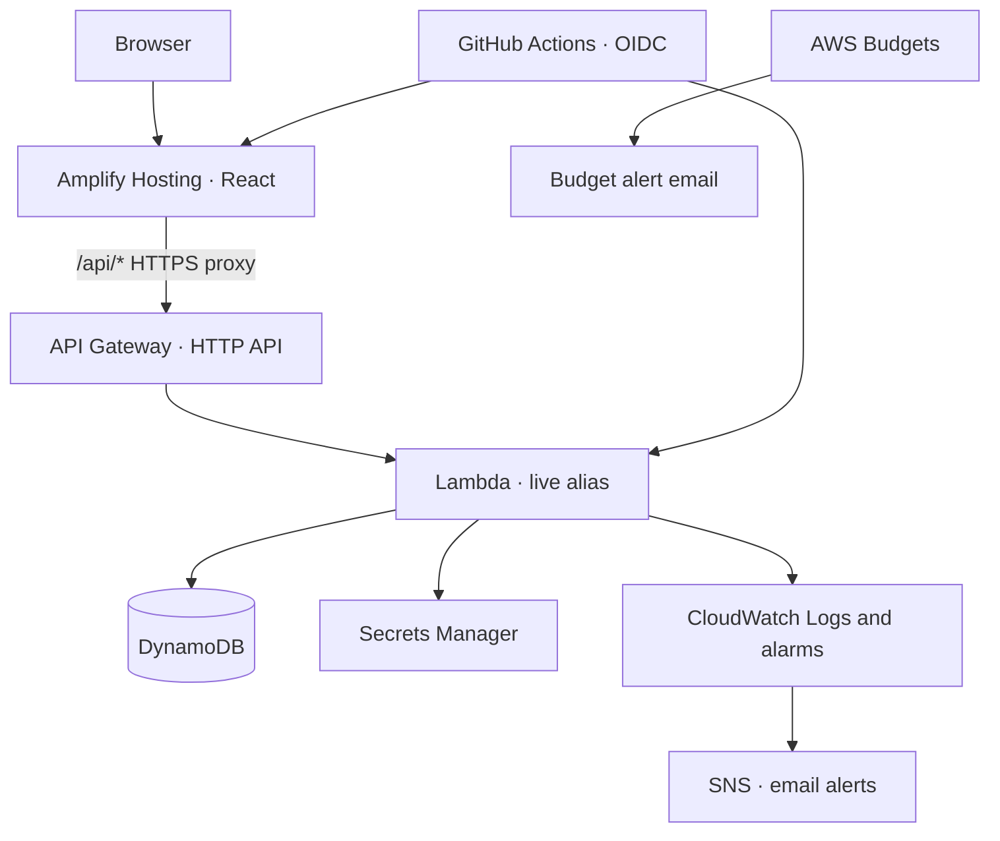

# People · Employee Workspace

**An employee directory with a React interface, a secure REST API, and a serverless AWS backend.**

Sign in, explore the dashboard, and add, edit, search, or delete employees. Run locally with SQLite, then deploy the same application to AWS with DynamoDB, Lambda, and Amplify Hosting.

[](https://github.com/sakthisaravanan8531-hue/employee-app/actions/workflows/ci.yml)


[Quick start](#getting-started) · [Architecture](#architecture) · [Tech stack](#tech-stack) · [Deployment](docs/deployment.md) · [Operations](docs/operations.md)

> **Project status:** The repository documents an implemented, locally tested application. Local validation does not establish a working AWS deployment or live URL. Follow the deployment and live acceptance checks for your environment.

## Why

A small employee application is a practical way to learn the complete path from a browser interaction to persistent cloud data. This project brings the interface, API, infrastructure, release automation, and operating instructions into one repository.

| Need | How this project handles it |
| --- | --- |
| Manage employee records | Dashboard and searchable directory with create, edit, and delete actions |
| Keep data after a restart | SQLite for local development; DynamoDB for AWS |
| Protect administrator access | Expiring signed sessions and a generated administrator secret |
| Release application changes | GitHub Actions verification, AWS OIDC, and versioned Lambda releases |
| Control a small demo's usage | API throttling, DynamoDB throughput ceilings, budget alerts, and an ON/OFF workflow |

## Features

- **Complete employee workflow** — sign in, view the dashboard, browse the directory, and manage names, emails, departments, and job titles.
- **Validated REST API** — strict input checks, UUID validation, duplicate-email handling, and useful HTTP errors.
- **Safe concurrent updates** — DynamoDB transactions enforce unique emails; revision checks return HTTP 409 for conflicting writes.
- **Local development without AWS credentials** — the launcher generates local credentials and starts the React frontend and SQLite-backed API.
- **Serverless infrastructure in code** — AWS CDK defines hosting, compute, database, secrets, monitoring, and deployment permissions.
- **Controlled releases** — publish immutable Lambda versions, update the `live` alias with a revision check, and restore the previous alias if backend health verification fails.
- **Application ON/OFF control** — pause backend invocations and publish an offline page while preserving employee records.
- **Operational documentation** — deployment, costs, rollback, failure drills, and validation instructions are included.

## Architecture



### Request flow

1. Amplify serves the React application over HTTPS on an AWS-provided domain.
2. Requests to `/api/*` pass through Amplify's proxy to API Gateway and the Lambda `live` alias.
3. The API checks the administrator session, validates input, and reads or writes employee records in DynamoDB.
4. CloudWatch collects application and access logs. Alarms notify the configured SNS email subscription.

DynamoDB stores employee records and email reservations. Transactions keep email uniqueness atomic during creation, changes, and deletion. The directory reads all result pages and sorts records for a small dataset.

The stack uses managed serverless services without EC2, RDS, a load balancer, or NAT gateways. Amplify manages frontend hosting and CDN delivery.

## Tech stack

| Layer | Technology |
| --- | --- |
| Frontend | React 19, Vite 7, HTML, CSS, JavaScript / JSX |
| API | Express 5, Node.js, Zod, JSON Web Tokens, Helmet |
| Cloud compute | AWS Lambda, Node.js 22, ARM64, `serverless-http` |
| Database | Amazon DynamoDB on AWS; SQLite locally |
| Secrets | AWS Secrets Manager |
| Infrastructure | AWS CDK v2, TypeScript, CloudFormation |
| Automation | GitHub Actions, AWS OIDC, Python 3 release and operations scripts |
| Quality | Node.js test runner, Supertest, Vitest, Testing Library, CDK assertions, Python unittest |
| Packaging | npm workspaces, esbuild |

### AWS services

| Service | Role |
| --- | --- |
| Amplify Hosting | Host the frontend and proxy API requests |
| API Gateway | Provide the HTTP API and stage throttling |
| Lambda | Execute the backend through a versioned `live` alias |
| DynamoDB | Persist employees and email reservations |
| Secrets Manager | Store the generated administrator credentials |
| IAM | Scope runtime access and GitHub deployment permissions |
| CloudWatch | Collect logs and evaluate error alarms |
| SNS | Deliver alarm notifications |
| AWS Budgets | Send configured account-wide spending alerts |
| CloudFormation | Provision infrastructure synthesized by CDK |

**Languages used:** JavaScript / JSX for the application, TypeScript for infrastructure, Python for release and operations scripts, HTML and CSS for presentation, and SQL through the local SQLite adapter. Workflow configuration uses YAML.

## Getting started

### Prerequisites

- **Node.js 24** and npm, matching `.nvmrc`.
- **Linux, macOS, or a Linux environment such as WSL** for the local launcher.
- **Python 3** for the full verification suite and release scripts.
- For AWS deployment: AWS CLI v2 and an authorized identity with the required infrastructure permissions.

Local development does not require AWS credentials, Docker, or a separate database server.

### Run locally

```sh
git clone https://github.com/sakthisaravanan8531-hue/employee-app.git
cd employee-app
npm ci
npm run dev:local
```

Open **http://localhost:5173**. The API runs on port **8080**.

The launcher creates a protected, Git-ignored `.env` with randomly generated administrator credentials. Read that file locally to sign in; keep its values private. Employee records persist in `.local/employees.sqlite`. Node's experimental SQLite warning is expected.

Press **Ctrl+C** to stop the development processes. The SQLite file retains your records.

### Verify

```sh
npm run check
```

This runs backend and frontend tests, production builds, bundled Lambda tests, infrastructure assertions, Python release tests, and offline CloudFormation synthesis.

With the development servers running, check the local application flow:

```sh
node --env-file=.env deployment/scripts/local-smoke.mjs
```

Cloud IAM, Amplify proxying, real DynamoDB transactions, and SNS delivery require separate live checks described in the [deployment guide](docs/deployment.md).

## Deploy to AWS

The default region is **us-east-1**. No domain purchase is required.

Start with the [deployment guide](docs/deployment.md), which covers the configured target account, CDK bootstrap, alert email, GitHub OIDC, and first publication.

The deployment sequence is:

1. Verify the AWS identity and run `npm run check`.
2. Review `cdk diff` and deploy the `EmployeeApp` stack using an authorized operator identity.
3. Configure the GitHub `production` environment and Actions variables from stack outputs.
4. Run **Test and deploy** to publish the backend and frontend.
5. Retrieve administrator credentials securely from Secrets Manager and complete live login and CRUD checks.

| GitHub Actions variable | Stack output |
| --- | --- |
| `DEPLOYMENT_ROLE_ARN` | `DeploymentRoleArn` |
| `AMPLIFY_APP_ID` | `AmplifyAppId` |
| `FUNCTION_NAME` | `FunctionName` |
| `API_URL` | `ApiUrl` |
| `APP_URL` | `AppUrl` |

A stack output URL becomes usable after frontend publication succeeds. If `DEPLOYMENT_ROLE_ARN` is absent, the workflow runs verification and skips deployment.

### Release and rollback

GitHub Actions verifies pull requests and pushes to `main`. Configured main-branch releases bundle the Lambda with its Git SHA, publish a new version, update the `live` alias, check health, and publish React to Amplify.

A failed backend health check restores the prior alias and reports failure. Frontend failures and application bugs that pass health checks require a known-good commit to be redeployed. Rollback does not undo employee data changes.

Infrastructure updates use a separate operator identity. The application release role does not have direct permission to read employee data or administrator secrets.

### Turn the application ON or OFF

Open **Actions → Application ON or OFF → Run workflow** on `main`.

| Option | Behavior |
| --- | --- |
| `off` | Block new backend invocations and publish the offline page |
| `on` | Verify, rebuild, redeploy, and resume the application |
| `status` | Read the backend concurrency state |

Push-triggered releases respect the OFF state. Pausing retains employees and can leave storage, hosting, secrets, and monitoring charges. See [application power controls](docs/application-power.md).

## API

| Method | Endpoint | Purpose |
| --- | --- | --- |
| POST | `/api/login` | Start an administrator session |
| POST | `/api/logout` | End the session |
| GET | `/api/me` | Return the signed-in administrator |
| GET | `/api/employees` | List employees |
| POST | `/api/employees` | Create an employee |
| PUT | `/api/employees/{id}` | Update an employee |
| DELETE | `/api/employees/{id}` | Delete an employee |
| GET | `/api/health` | Check database connectivity and release version |

Employee creation and updates accept:

```json
{
  "name": "Alex Morgan",
  "email": "alex@example.com",
  "department": "Engineering",
  "title": "Software Engineer"
}
```

Employee endpoints require a valid session. Mutations require JSON. Invalid input returns HTTP 400, duplicate emails or conflicting writes return HTTP 409, and missing employees return HTTP 404.

## Cost controls

The infrastructure includes:

- DynamoDB on-demand capacity with configured read/write throughput ceilings.
- API Gateway throttling at 2 requests per second with a burst of 5.
- A 256 MB Lambda with a 15-second timeout and no provisioned concurrency.
- Seven-day application and API log retention.
- Two error alarms with optional email notifications.
- An optional account-wide monthly budget, defaulting to $5 when an alert email is configured.

**Budget alerts and throttling are not hard spending caps.** Actual charges depend on usage, region, and account eligibility. OFF mode does not remove all charges. Review [costs and cleanup](docs/costs.md) before deployment.

## Project structure

| Path | Contents |
| --- | --- |
| `frontend/src/` | React interface, styles, and interaction tests |
| `backend/src/` | Express routes, authentication, configuration, Lambda entry point, and storage adapters |
| `backend/test/` | API and DynamoDB tests |
| `deployment/lib/employee-stack.ts` | AWS CDK infrastructure |
| `deployment/scripts/` | Build, local development, release, smoke-test, and power-control tools |
| `deployment/test/` | Infrastructure, bundle, release, and operations tests |
| `deployment/maintenance/` | Offline page |
| `.github/workflows/` | Verification, deployment, and ON/OFF workflows |
| `docs/` | Deployment, operations, costs, validation, and architecture documentation |

## Security notes

- Administrator credentials are generated in Secrets Manager for AWS and in an ignored local `.env` for development.
- Sessions use signed, expiring HttpOnly cookies with SameSite Strict and Secure enabled in production.
- The API rejects cross-site mutations and non-JSON writes, validates inputs, and disables response caching.
- Login rate limiting and API Gateway throttling reduce abusive traffic; the in-process login limiter is not a distributed account lockout.
- DynamoDB encryption is enabled. The table is deletion-protected and retained during stack removal.
- GitHub Actions uses short-lived OIDC credentials with an exact repository/environment trust subject.
- Frontend security headers include a Content Security Policy.

Never commit administrator passwords, session secrets, or AWS access keys.

## Documentation

| Guide | Covers |
| --- | --- |
| [Deployment](docs/deployment.md) | Initial infrastructure, GitHub setup, live checks, and cleanup |
| [Operations](docs/operations.md) | Day-to-day operation and recovery |
| [Application power](docs/application-power.md) | ON/OFF behavior and failure handling |
| [Costs](docs/costs.md) | Cost controls and remaining charges |
| [Failure testing](docs/failure-testing.md) | Controlled failure drills |
| [Inventory](docs/inventory.md) | Resource inventory |
| [Validation](docs/validation.md) | Validation scope and evidence |
| [Architecture source](docs/architecture.drawio) | Editable draw.io diagram |

## Limitations

- This is a small demonstration with one administrator; organizational identity management and role-based access are outside its current scope.
- The directory scans and sorts employee records, making it suitable for a small dataset.
- Live deployment and cloud failure tests must be verified in the target environment.
- The former PostgreSQL implementation remains in Git history at `3c5d6c4`; there is no automatic migration to DynamoDB.
- Deploying this design does not remove resources from an earlier stack. Review any retained RDS instances, snapshots, or buckets separately.
- Stack deletion retains the protected DynamoDB table. Export needed records and follow the documented cleanup procedure.

## License

This repository does not currently include a license file. Reuse permissions should be clarified with the repository owner.
