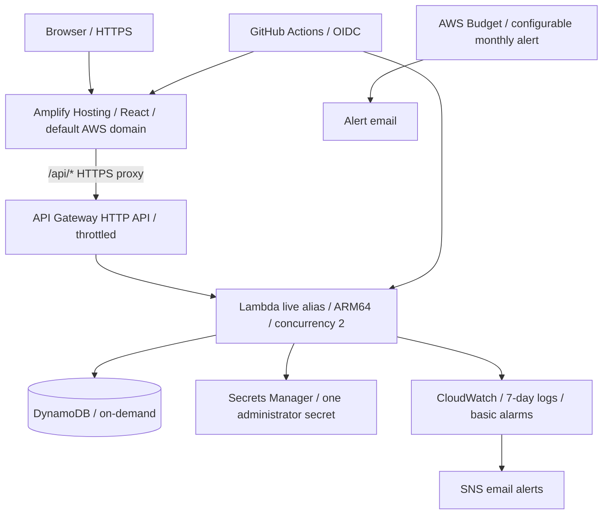

# People — low-cost employee workspace

React frontend, Node.js API and DynamoDB, deployed with AWS Amplify Hosting, Lambda and API Gateway. The owner approved replacing the original EC2/ASG/ALB/RDS assignment with a lower-cost serverless design.

**AWS target:** account `912010732788`, region `us-east-1`. **No domain purchase required.**

**Status:** implemented and locally tested; live AWS deployment still requires an authorized AWS identity. No live URL or AWS failure-test result is claimed by local validation.

## Run locally

Use Node.js 24 and npm on Linux/macOS:

```sh
npm ci
npm run dev:local
```

The launcher creates a protected, ignored `.env` containing randomly generated local administrator credentials, then starts the React development server on port 5173 and API on 8080. Read `.env` locally to sign in; do not publish its values. Local employee records persist in `.local/employees.sqlite` through the SQLite development adapter. AWS uses DynamoDB, not SQLite. No AWS credentials, Docker or separate database process are needed locally. Node's experimental SQLite warning is expected.

```sh
npm run check
# While the development servers are running:
node --env-file=.env deployment/scripts/local-smoke.mjs
```

`check` runs the API persistence/security tests, DynamoDB request/transaction tests, React interaction tests, production builds, bundled Lambda API Gateway event test, CDK assertions, release/rollback tests and offline CloudFormation synthesis. Cloud API behavior still requires live acceptance tests. Ctrl+C stops the local process group; the SQLite file retains records.

## Application

Sign in → dashboard → employee directory → add, edit, search and delete employees.

| Endpoint                                             | Purpose                               |
| ---------------------------------------------------- | ------------------------------------- |
| `POST /api/login`, `POST /api/logout`, `GET /api/me` | Administrator sessions                |
| `GET /api/employees`                                 | List employees                        |
| `POST /api/employees`                                | Create employee                       |
| `PUT /api/employees/{id}`                            | Update employee                       |
| `DELETE /api/employees/{id}`                         | Delete employee                       |
| `GET /api/health`                                    | Database connectivity and release SHA |

Mutations use JSON with `name`, `email`, `department` and `title`. Fields and UUIDs are validated. Sessions use expiring signed HttpOnly cookies, Secure in AWS and SameSite Strict. Cross-site writes and form posts are rejected; API responses are not cached. One administrator is generated securely in Secrets Manager. This is a small demo, not an organizational identity-management platform.

## Architecture



There are **no EC2 instances, ASG, ALB, NAT gateways, VPC Link or RDS** in the new stack. Amplify manages frontend HTTPS/CDN/storage. DynamoDB has no database-server idle charge. Lambda has no provisioned concurrency. See [cost controls](docs/costs.md) for limitations: this is lower-cost, not a guarantee of free hosting.

DynamoDB stores employee items plus email-reservation items. Transactions make unique email checks atomic, including email changes/deletes. Revision conditions reject concurrent updates with HTTP 409 instead of silently losing a write. The directory scans all pages and sorts employees; this is intended for a small demo dataset, not a large enterprise directory.

## Build and release

`npm run build:backend` bundles the Lambda and AWS SDK into `.local/lambda` and records its Git SHA in `VERSION`. CDK packages that directory. GitHub Actions runs tests/build/synthesis before deployment. When repository variables are configured, it updates Lambda code, publishes an immutable version, moves the `live` alias with an optimistic revision check, verifies health, then publishes React to Amplify. A failed backend health check restores the previous alias and leaves the job failed. Frontend failure leaves the healthy backend in place; revert/redeploy a known-good main commit to restore compatibility.

Infrastructure changes use a separate authorized operator identity and CDK. Application releases cannot read employee records or administrator secrets. See [deployment](docs/deployment.md), [operations](docs/operations.md), [failure testing](docs/failure-testing.md), [inventory](docs/inventory.md), [validation](docs/validation.md) and the editable [draw.io diagram](docs/architecture.drawio).

## Turn the app ON or OFF

Open GitHub **Actions → Application ON or OFF → Run workflow** on main, then select `on`, `off` or `status`. OFF blocks backend invocations and publishes an offline page without deleting employees. ON verifies and redeploys the app. Automatic code releases respect the OFF state. Remaining storage/hosting/monitoring charges still apply. See [the switch instructions](docs/application-power.md).

## Earlier architecture

The former PostgreSQL implementation remains in Git history (`3c5d6c4`). There is no automatic data migration from it. Existing ignored local PostgreSQL data is left untouched. If anyone deployed the older AWS stack separately, review its retained RDS/bucket resources: changing source or deploying this new template does not prove that old charges stop.
